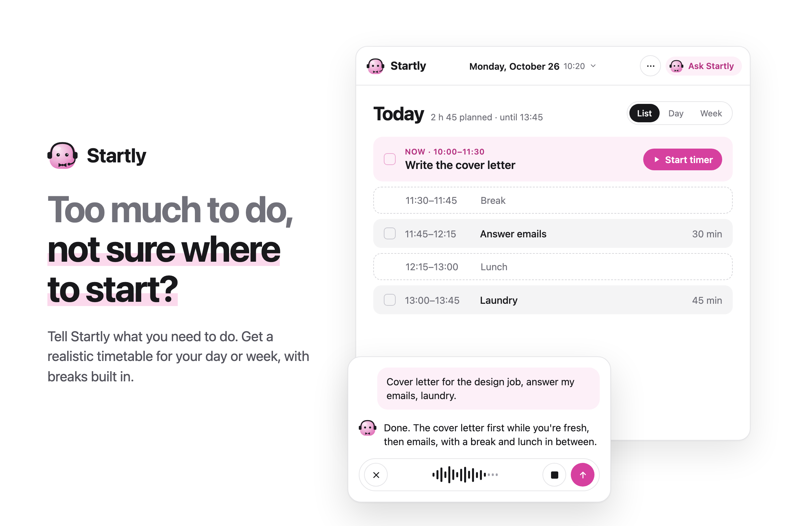

# ✨ Startly

**Too much to do and don't know where to start? Start here!**

Startly is an AI-powered planning assistant that turns your to-do list into a realistic daily or weekly schedule.

Instead of wondering what to do first, just tell Startly what's on your mind. It helps you prioritize your tasks, decide when to do them, and adjust your schedule when plans change.




## Features

- 🤖 **AI planning** — Organize your day or week through natural conversation.
- 📅 **Three views** — Switch between a checklist, daily calendar, and weekly calendar.
- 🔄 **Smart rescheduling** — Tell Startly what changed, and it reorganizes your schedule.
- 💬 **Realistic planning** — If not everything fits, Startly asks what you'd like to change instead of silently dropping tasks.
- ⏱️ **Focus timer** — Choose between Pomodoro and a normal countdown.
- 🔔 **Browser notifications** — Get reminders for tasks, focus sessions, and breaks on desktop.
- 🎙️ **Voice input** — Speak instead of typing.
- 🎨 **Personalization** — Theme colors, task animations, and confetti when you finish everything!

Startly works on desktop and mobile. No sign-up required: your tasks and settings are saved locally in your browser. Your messages are sent to OpenAI to build your plan, and nothing is stored on a server. Use **Start Fresh** to reset your planner.

## 🧠 How It Works

Startly combines AI with a scheduling system written in TypeScript.

1. **Describe your plans** in natural language.
2. **OpenAI understands your request** and returns structured actions.
3. **The TypeScript scheduler** builds your timetable based on availability, priorities, and deadlines.

**The AI understands your plans. The code builds your schedule.**

## 🛠️ Tech Stack

- **Frontend:** React, TypeScript, Vite, Tailwind CSS, Radix UI, Zustand
- **Backend:** Node.js, Express, OpenAI API, Zod
- **Testing:** Vitest, Playwright
- **Deployment:** Vercel

Built with the help of **Claude Code** and the **Devpost Learn Skill Pack**.

## 🚀 Run Locally

Requires **Node.js 20+** and an **OpenAI API key** (used for both planning and voice input).

**1. Clone the repository and install dependencies:**

```bash
git clone https://github.com/Hibashii/Startly.git
cd Startly
npm install
```

**2. Configure environment variables:**

```bash
cp .env.example .env
```

Add your `OPENAI_API_KEY` to `.env`. Never commit your API key.
Optional: `OPENAI_MODEL` and `RATE_LIMIT_PER_HOUR` (requests per hour) can also be changed in `.env`.

**3. Start the application:**

```bash
npm run dev
```

Open **http://localhost:5173** (the development API runs on port `3001`).

## 🧪 Tests

```bash
npm test       # Scheduler and API tests with Vitest (OpenAI mocked)
npm run e2e    # Playwright browser tests (API mocked)
```

## 🔔 Notifications

Startly can send desktop browser notifications when a task is about to start, a focus timer finishes, or a Pomodoro session or break ends. When prompted, click **Allow**. Notifications are currently supported on desktop only.

<details>
<summary>Not receiving notifications?</summary>

- **macOS:** System Settings → Notifications → your browser → Allow notifications. Make sure Do Not Disturb is off.
- **Windows:** Settings → System → Notifications → turn on notifications for your browser.
- **Browser:** Open the site's permissions and set Notifications to Allow.

</details>

## 🌱 What's Next

Startly started as a hackathon project, and I'm still improving it! Next up: accounts with login, editing your calendar by hand, and a few surprises 👀

---
